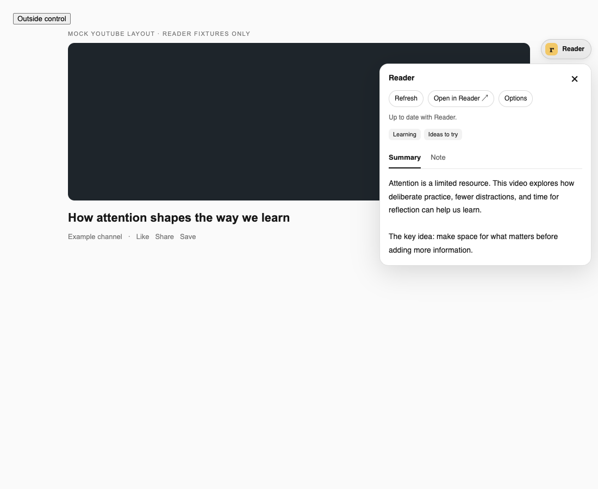
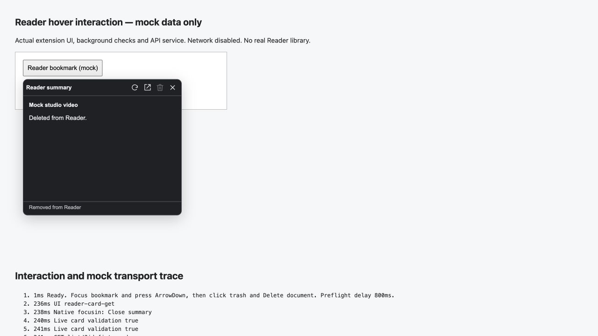
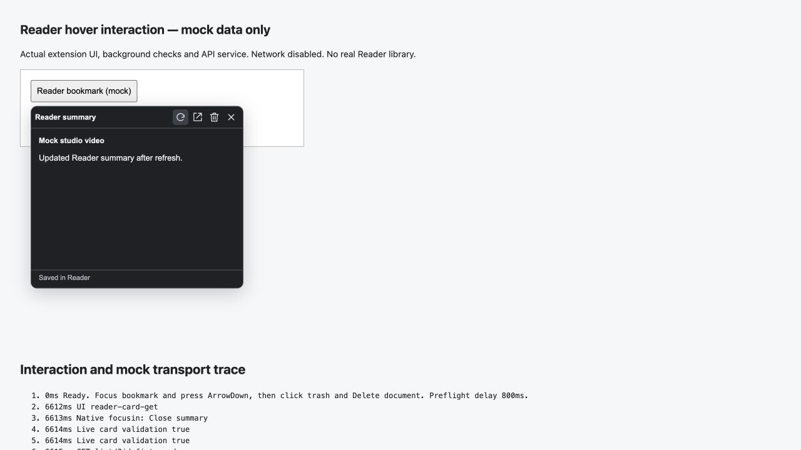
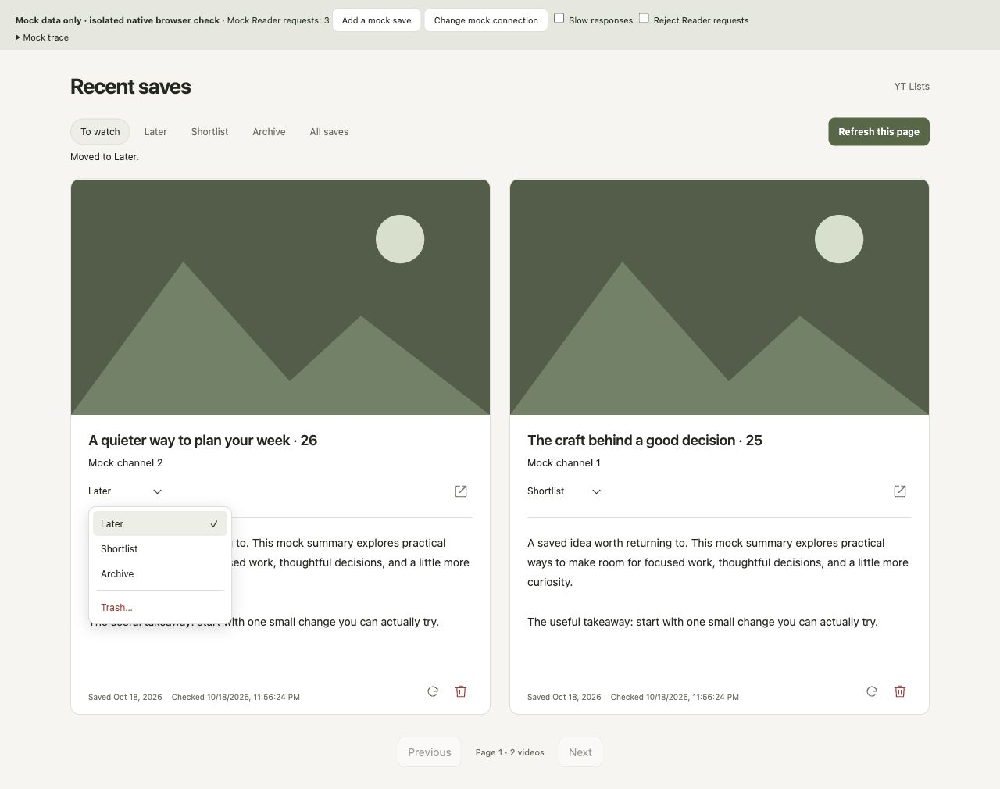

# Minimal Video Speed

Minimal Chrome extension that injects a compact hover-only speed controller into the top-left corner of each HTML5 video.

## Controls

- The controls appear only while the pointer is over a video
- Hovering configurable center bands on the video can temporarily preview it at lower speeds
- `-` decreases playback speed by the configured overlay step for that specific video
- `1x`, `2x`, `3x` jump that video to preset speeds
- `+` increases playback speed by the configured overlay step for that specific video
- The picture-in-picture button toggles PiP for that specific video when the site allows it
- The speed readout shows the current saved speed for that video
- The Downie icon opens the current video or page in Downie when possible
- The cloud icon saves YouTube videos and embeds to Raindrop.io's Unsorted collection and highlights videos already saved by the extension
- On X/Twitter, the separate download-to-tray icon saves the highest-resolution complete MP4 exposed by that player, using bitrate to break ties. It verifies both audio and video tracks before downloading and never silently falls back to a lower quality

## X/Twitter downloads

X Broadcasts offer both the direct MP4 download button and **Open in Downie** in the same hover controls. The direct button uses the existing MP4 detection and audio verification; if the player does not expose a complete MP4, it reports an error. The Downie button sends the Broadcast page URL so Downie can resolve its stream and title. Downie manages its download and filename.

If the controls do not appear, check the extension's **Site access** in `chrome://extensions`. With **On click** access, activate the extension from its toolbar button on the X tab and reload the page if prompted. Hover controls require access to that page.

After updating the extension, reload it in `chrome://extensions` (also in Arc), then reload any open X tabs. Open/play an accessible video, signed in or logged out, and hover over it to use **Download highest-quality X video with audio**. The file is saved through the browser's normal downloads flow; check the browser's Downloads list for progress, completion, or an interrupted transfer.

Filenames use `@handle tweet-id Display Name Tweet text….mp4`. Tweet text is capped at 80 characters, with whole emoji preserved; invalid filename characters and line breaks become spaces. Very long names/text are shortened further to fit filesystem limits. The ID is always included, even for posts without text. Missing names/text are omitted; if post metadata cannot be identified, the filename falls back to `x-video media-<media-id>.mp4`. Metadata is matched to the selected video, including quoted/reposted videos, and duplicate downloads receive the browser's normal numbered suffix.

The extension reads only that player's available renditions and matching post metadata when clicked. It does not send posts to a downloader service, copy login credentials, or keep private video URLs or post text in extension storage. The browser uses the current profile's session for media requests. This adds the `downloads` permission and access to `https://video.twimg.com/*`; [Chrome's downloads API](https://developer.chrome.com/docs/extensions/reference/api/downloads) handles saving the original file without re-encoding.

"Highest quality" means the largest complete MP4 rendition X supplies to the current player, not the original uploaded file or a potentially higher streaming-only rendition. The newer logged-out player exposes one complete MP4 through its download URL; the extension uses that file and reads matching Relay post metadata for the same filename format as signed-in downloads. If post text is unavailable, it is omitted. The downloaded MP4 must contain both audio and video tracks. Silent GIFs, live streams, DRM media, HLS-only videos, unavailable/expired media, or files whose tracks cannot be verified produce an error instead of a misleading download. Access depends on the post and its media being available in your current browser session. X's internal player metadata can change; if detection stops working, reload the tab first.

## Settings

- Open the extension details page in `chrome://extensions` and use **Extension options**
- Overlay step can be set to any value from `0.01` to `16`
- Hover preview defaults to center `20%` at `1x`, then `10%` per side at `1.5x`, then another `10%` per side at `2x`
- Each hover band width can be set from `0%` to `100%`
- Each hover band speed can be set from `0` to `16`
- The options page supports direct number input plus `-0.25` and `+0.25` adjustments
- Reader saving requires a Readwise access token in **Extension options**
- Raindrop saving requires a Test token from your Raindrop.io app in **Extension options**; the token is stored locally in this browser
- **Icon order** lets you move overlay actions left or right; unavailable actions stay hidden
- **Focus mode** hides YouTube Home and Subscriptions feeds; toggle it on/off in **Extension options** or YT Lists' filters
- **Daily unblocks** defaults to `3` and can be set from `0` to `100`; `0` disables unblocking while focus mode is on. Changes apply to open YouTube tabs, preserving today's usage
- Each unblock keeps the 30-second delay. **Day ends at** controls when the allowance resets (default: `02:00`, local time)
- The chosen setting applies globally, including embedded videos

## Embeds

- The content script runs in all frames, including related `about:`, `blob:`, and embedded iframe contexts, so embedded players get their own overlay too
- Picture-in-picture availability still depends on the browser API and the site or embed permissions policy, so some videos may not expose the PiP button
- The Reader icon saves the top-level page URL, while the Downie icon prefers the direct video URL when one is available

## Load In Chrome

1. Open `chrome://extensions`
2. Enable **Developer mode**
3. Click **Load unpacked**
4. Select the extension folder you cloned or downloaded locally

## Reader panel on YouTube

In **Extension options → Reader**, enable **Reader panel on YouTube**. It defaults to off. On a YouTube watch/live page, click the book icon in the page’s top-right corner to open a popover with **Summary**, **Note**, the current Reader location, tags, **Refresh**, a **More** menu, and **Close** in one compact header row. Click the tag chip to show all tags; long names truncate and narrow windows show a tag count. It shows the existing Reader summary and Document Note. The playback overlay and its one-click save work independently. No new permissions are required.

- The **Refresh** icon fetches the current Reader document. Missing summaries mean no summary has been returned yet; Reader may still be processing the video or automatic summaries may be disabled. This extension does not generate summaries or invoke Ghostreader.
- Close with **Escape**, the close button, or an outside click. Keyboard users can use arrow keys/Home/End to switch views; Escape/Close returns focus to the launcher. The popover fits the viewport and does not move the page content.
- An open popover follows YouTube video navigation and refreshes the current video's Reader data without reloading the page or extension. A closed popover stays closed and does not fetch until opened. Opening binds to the current URL even before YouTube's navigation event arrives. Timestamp/hash changes for the same video keep its state without another request. Drafts remain separate for each video; late replies from previous visits cannot replace the current editor.
- Drag unused header background to reposition the open popover. Controls and text keep their normal behavior. The position stays in this tab across dismissal/video changes, clamps to the viewport after resize, and resets to the corner on a full page reload.
- Choose **System**, **Light**, or **Dark** in **Extension options → Reader → Popover theme**. System is the default and follows live system appearance changes. Launcher hover remains opaque in every mode.
- Note typing is isolated from YouTube shortcuts while native editing/selection and browser commands remain available. Escape closes the popover after the key is released; Escape during IME composition stays in the editor.
- Successful note saves show **Saved** beside the save button for three seconds, then clear. The reserved feedback slot and overlaid error/conflict details keep the editor in place; errors remain until addressed. New edits or a new save attempt clear old success feedback.
- **Save note** explicitly replaces the Document Note. Saving an empty note clears it. Tags are display-only. Reader content is shown as plain text, including any Markdown/HTML markup.
- The location dropdown follows **Note** and precedes tags. Choose **Later**, **Shortlist**, or **Archive** to move the captured document. It rechecks the source, ID and current location before PATCHing **only** `location`, then reads back Reader’s actual location. It keeps the Note tab and draft, including newer text typed while the move is pending. Changed locations require review; an uncertain move requires Refresh and never automatically retries. Reader can fall back to an account’s enabled default, which is shown honestly. `new` is labelled **Inbox / New**, never Later; other/unknown locations remain explicit.
- **Trash** in the location dropdown opens the existing **Delete from Reader** confirmation naming the document, video URL, and Reader ID. Nothing is deleted until **Delete document** is clicked. Trash uses DELETE, not a `location: trash` update. Deletion includes the document's highlights and their notes. Cancel/Escape preserves the draft; confirmed deletion also keeps any unsaved local note in this tab for copying. It cannot be saved until a matching document exists again and any replacement conflict is reviewed. No automatic re-save occurs.
- The **More** (ellipsis) menu contains readable **Open in Reader**, **Options**, and **Recent saves** actions. Both menus support arrow keys, Home/End, Escape and Tab; dismissal, navigation and identity changes close stale menus. Refresh remains directly accessible in the header.
- Hover the collapsed launcher for 300 ms to see a temporary, read-only summary peek. Enter the peek to read/select text; leaving closes it after a short grace period. It never changes the Summary/Note selection, focus or draft, and it is suppressed while the normal panel is open or working. Clicking the launcher pins the normal panel with its previous tab/draft. Peek reads use the existing bounded lookup, never save or regenerate summaries, cache at most 20 videos for up to a minute (15 seconds for an unavailable summary), and stop on navigation, hidden tabs or identity/credential changes. A peek’s own newly linked ID does not cancel its response. No polling runs in the background.
- Deletion rechecks the captured document's source, title, note, and update timestamp. Changes require review and fresh confirmation. Confirmed removal (or an already-absent document) invalidates matching IDs and saved flags, including canonical URL aliases; a newer replacement save is retained. Authentication/rate/network failures keep drafts and never report unconfirmed success. An uncertain deletion must be checked with Refresh before retrying.
- The [Reader API](https://readwise.io/reader_api#document-delete) documents `DELETE /api/v3/delete/<document_id>/` and `204` success. Reader's [app documentation](https://docs.readwise.io/reader/docs/faqs#can-i-restore-documents-that-ive-previously-deleted) describes device-specific Trash, but does not establish recovery behavior for API deletions. This extension offers no Undo or recovery promise. Preflight checks are not atomic with either note updates or deletion; another client can change a document between requests.
- Unsaved drafts are retained per video in this tab through YouTube navigation, dismissal, switching Summary/Note views, remounts, refresh, and pending requests. Edits typed during a save remain unsaved after that save completes. Drafts are held in memory: copy or save them before a full page reload, tab close, browser crash, or extension reload. The tab requests the browser's leave-page warning when drafts are dirty; the browser controls whether that warning is shown.
- Every save first re-reads the captured Reader document, verifies its source video, and compares its note with the editing baseline. If it changed, compare the Reader note and choose **Use Reader note** or **Keep my draft for next save**, then save explicitly. Reader's public API has no atomic conditional update: another client can still change the note between this check and the PATCH. Concurrent saves through this extension are serialized.
- Newly saved videos retain a canonical video URL → Reader document ID mapping. Existing/externally saved videos are matched by source URL in one page of up to 100 Reader `video` documents per panel lookup. **Search next 100 videos** continues manually. There is no automatic full-library scan or save on navigation/panel open. Older videos can require multiple clicks; documents Reader classified outside `video` are found only if their ID was retained by this extension. Deleted/stale IDs are verified and discarded before discovery.
- Panel reads are capped locally below Reader's list limit. HTTP 429 cooldowns honor `Retry-After` (at least one minute) and survive service-worker restarts. Only a transient video-identity rejection gets one automatic read retry after 250 ms, cancelled on navigation or dismissal; writes, offline/auth/rate errors are never automatically retried. A failed or timed-out note write may have reached Reader: the draft stays intact, and **Refresh** checks the actual note before another attempt.
- Background requests validate the extension, top frame and YouTube origin, then read Chrome's current tab URL before Reader operations, including after queued work and before a note/delete write. The sender's original context URL may refer to a previous video or Home; it is not used as current video identity. A different current or pending video rejects the request, while the Reader document's exact ID and source checks remain in place. This uses the existing tabs permission.



The previews use a mock YouTube layout and mock Reader data, captured before the trash action was added. [Dark Note preview](docs/reader-panel-dark-note-mock.png).

Location mapping references: Reader’s [API list values and PATCH semantics](https://readwise.io/reader_api), [official CLI location support](https://docs.readwise.io/tools/cli#move-documents-to-archive-later-or-shortlist), and [Reader location workflows](https://docs.readwise.io/reader/guides/filtering/syntax-guide). The API’s LIST table and official CLI include `shortlist`; its PATCH table currently omits it. The extension sends the literal `shortlist` value and verifies readback rather than assuming the move succeeded. Account behavior still needs live manual validation; tests use fixtures and never move real documents.

The panel currently targets standard desktop/mobile watch and live pages, and hides during fullscreen playback. Shorts and embeds retain the existing save/playback controls. Summary polling, tag editing, transcript/highlights, and Ghostreader chat are outside this version.

### Development checks

No build step or lint configuration is required for this plain JavaScript extension. Install the pinned, test-only IndexedDB fixture dependency, then run syntax and regression checks with Node.js (18+):

```sh
npm ci --ignore-scripts --no-audit --no-fund
for file in *.js tests/*.js tests/*.cjs; do node --check "$file" || exit; done
npm test
git diff --check
```

Optional browser checks use Playwright with a fresh headless Chromium profile. Every page/network response and Reader operation is mocked; they do not install the extension into your browser or use real Reader credentials/notes. Install Playwright locally if needed (keep `node_modules` untracked), then run:

```sh
npm install --no-save --package-lock=false playwright
npx playwright install chromium
node --test tests/reader-panel.browser.cjs
```

An existing Playwright module/browser can be supplied with `PLAYWRIGHT_MODULE` and `PLAYWRIGHT_CHROMIUM_EXECUTABLE`. Browser checks cover SPA drafts, late fetch/save responses, external note conflicts, explicit clearing, inert remote HTML, remounts, dismissal/focus/keyboard tabs, host capture/bubble shortcut isolation, native text/selection and composition, all theme modes/live system changes, opaque hover contrast, drag/clamping/resize, fixed save/error/conflict geometry and success expiry, all header icon actions, tag overflow, viewport bounds in light/dark/mobile/short windows, and existing playback/one-click save. Fixture screenshots are written under `output/playwright/`. These checks do not validate YouTube's live DOM or Reader's live authenticated responses; a manual smoke test in a separate test profile is still needed before release.

The Note editor is a script-free, same-origin iframe with a native textarea, so keyboard events have their own browsing-context path rather than being retargeted to the shadow host on YouTube. Tests exercise event isolation and native defaults; real OS clipboard/IME and live site/browser-extension combinations still need manual testing.

`tests/reader-panel.test.js` also runs the actual panel controller against a small Node DOM/editor fixture. Together with `tests/reader.test.js`, it covers deletion confirmation/cancellation, exact identity, changed documents, retained drafts, SPA and late responses, credential changes, cache invalidation, already-absent documents, uncertain outcomes and inert remote titles without launching a browser or making network requests.

Location/menu/peek fixtures additionally cover location-only PATCH bodies and verified results, conflicts/fallback/uncertainty, pending-move drafts and navigation, keyboard/dismissal, temporary hover caching, own-discovery storage events and inert summary HTML. Optional browser scenarios were updated for the new menus and include narrow-view geometry and peek focus/draft checks, but were not run for this change: the earlier disposable Chromium launch failed before test bodies. No live YouTube layout or authenticated Reader move is claimed as verified.

## Saved-card Reader previews

On Home, subscriptions, search, channel and other supported YouTube card layouts, hover an already-saved card's Reader bookmark icon for 300 ms to show its summary. The icon keeps its existing click-to-save/open behavior. Keyboard users can focus the Reader icon and press **ArrowDown** to enter the preview; **Escape** closes it and returns focus. Move into the popover to read or select text. It uses the existing **System / Light / Dark** theme, fits the viewport, and reserves a fixed area for loading, summary, confirmation and error states. The watch-page panel and playback controls work independently.

- Only cards already marked saved are eligible. Scrolling and hovering unsaved cards do not request summaries or save anything. Hover intent is cancelled on departure, and leaving the popover gets a short grace period. Cached summaries are held for up to a minute, capped at 50 videos; Refresh bypasses this cache. Credential and saved-document changes invalidate it. Late replies are ignored after card recycling, departure or YouTube navigation.
- Known document IDs use a direct Reader lookup. Older locally saved cards without IDs share **one page of up to 100 video documents per minute across the extension**, including worker restarts. There is no hover pagination or whole-library scan. If an older save cannot be linked, use Reader or the watch-page panel's manual search. Externally saved videos without a local saved indicator are not discovered eagerly.
- **Delete from Reader** opens a confirmation naming the exact video and Reader ID; Cancel is focused by default. Confirmation includes deletion of highlights/notes and offers no Undo promise. The extension rechecks the current YouTube page and challenges the isolated card context before requests, including after document preflight and before DELETE. A changed, ambiguous, removed or recycled card cancels the operation. Card requests have a separate target flow; watch-page mutation guards remain strict.
- Explicit Refresh and confirmed Delete share one request lifecycle: focus moves to the stable popover body before the clicked control is disabled or hidden, and automatic hover/focus departure cannot dismiss that pending action. Refresh bypasses cached data and keeps the updated result or error visible without another hover; repeated activation is ignored. Initial hover-only reads retain ordinary leave/cancellation behavior. Explicit Close, Escape, outside click, navigation, recycled cards and credential changes still dismiss/invalidate the session. This avoids native focus-out races that previously closed the popover after 180 ms during a slow refresh or before DELETE was sent.
- Deletion verifies the captured document ID, source video, note, title and update timestamp. Changed documents require Refresh and fresh confirmation. The hover panel reports success only after the exact ID receives `DELETE /api/v3/delete/<id>/` with HTTP `204`, followed by an uncached lookup confirming that ID is absent/deleted. A missing preflight target sends no DELETE and is shown explicitly; a DELETE `404`, a still-present document, or failed verification never becomes success or a red deletion marker. Saved flags stay intact on these unconfirmed paths. Refresh is required before another confirmation; no mutation automatically retries. Reader may take time to reflect an accepted deletion, so a still-present readback means unverified, not proof the DELETE was rejected. This verifies the matched Reader ID, not every document in the library. Existing dirty Document Note drafts remain in their tabs, including when a card is deleted elsewhere. No automatic re-save occurs.
- A confirmed successful extension deletion leaves a **red filled slashed bookmark** with the tooltip “Deleted from Reader by this extension. Click to save again”. This is a custom inline SVG, consistent with the existing icons; no SF Symbols dependency is used. The recent per-video record persists across navigation/reloads (up to 2,000 canonical videos), applies to duplicate cards, and takes precedence over stale saved flags. Absence, failed or uncertain deletions do not invent deletion history. An intentional successful re-save or newer verified Reader presence clears the marker. This records only what the extension knows, not global Reader history.
- API limits and persisted cooldowns are shared with the watch-page panel. Missing or unready summaries and failures are shown explicitly. Data is rendered as plain text, and credentials remain in the background worker. No permissions or runtime dependencies are added.

Node fixtures cover card surfaces/aliases, saved eligibility, hover cancellation, caches, stale replies, card validation, keyboard/Escape, deletion, errors and watch-page draft preservation. Real YouTube markup, text selection, positioning and layout stability still need a manual browser check. The previous full disposable Chromium suite failed before test bodies; the focused in-app browser interaction checks below are separate.

The hover deletion regression fixtures also connect the actual card controller to the actual background guard and Reader service with synthetic Chrome messaging and HTTP responses. They assert the exact method, URL, ID and status path, including cases where no DELETE is issued, Reader rejects DELETE, or HTTP 204 is followed by a still-present record. Transport-only fixtures do not exercise native focus; the browser reproduction below covers that boundary without modifying a real Reader library.

A focused in-app browser test additionally reproduced the confirmation focus race with real pointer/focus events and an 800 ms mock preflight. Before the fix, native focus-out from the hidden Delete button started the close timer, the popover closed, card validation failed, and no DELETE was sent. Afterward it stayed open through the actual background/service route, sent one exact mock DELETE, required HTTP 204 and absent-ID readback, and showed success; a mock 401 stayed visible as an error. Native keyboard confirmation also passed with the production closed shadow-root mode. The earlier full Playwright suite was not rerun. These focused checks use a temporary localhost fixture and synthetic credentials/data; pointer automation uses a test-only open root for locator access, while production roots remain closed. They do not load an extension into the user's browser or validate live YouTube markup/Reader behavior. [Recorded mock browser traces](docs/reader-hover-delete-native-traces.txt).



To reproduce offline, run `node tests/reader-card-interaction-fixture.cjs`, serve only `output/hover-interaction-fixture` on loopback, and open `hover.html?delay=800&open=1`. Focus the mock bookmark, press ArrowDown, click trash and confirm. The trace is visible in the page; `outcome=unauthorized` or `outcome=still-present` tests error paths. The optional third script argument supplies an old card UI Git revision for a before/after comparison (second argument is the output directory). All API responses are in memory, outbound fetch/navigation is blocked by the fixture, and no real Reader credentials are used.

For Refresh, add `action=refresh`; `outcome=unauthorized` simulates a rejected read. Native pointer checks reproduced the previous disabled-button blur/dismissal, then verified an 800 ms refresh stayed open for both updated data and a visible 401 error. The shared-lifecycle deletion check also passed again. [Refresh mock traces](docs/reader-hover-refresh-native-traces.txt).




## Recent saves

Click the extension’s browser-toolbar action or the compact **Recent saves** floating bookmark button (bottom-left by default). The same route is available from Reader’s More menu, YT Lists, and Options. It activates an exact existing Recent saves tab when safe, preferring the source window; otherwise it opens one. Pending/navigated/lookalike tabs and other private contexts are not reused. Rapid activations share an in-flight open. The page has a single **YT Lists** link at the top right; theme preference remains in Options elsewhere.

The page shows **12 cards per page**, newest first, with two substantial cards side by side or one column when narrow. Large lazy thumbnails and titles both open YouTube directly. Each card has its channel close below the title, a flat custom location menu, Reader icon, full cached summary, Saved/Checked footer, and Refresh plus Trash icons. Visible tags and field labels are removed; Reader’s actual tags are untouched. The location trigger has no hover background. Its text aligns with the title/channel edge; the styled menu supports arrows, Home/End, typeahead, Enter/Space, Escape, Tab and outside dismissal, with checked location and captured-target guards. Both Trash entry points use the same exact-document confirmation and verified deletion flow. Cancel returns focus to the originating control.

Thumbnails request YouTube’s maximum-resolution image (normally 1280×720) instead of the previous 320×180 source. Only missing, failed or undersized images step down through standard/high/medium; resolutions are not fetched in parallel. Images remain lazy, with a fixed 16:9 area. If all sources fail, the area stays clickable and shows “Thumbnail unavailable”. [Resolution/fallback checks and limits](docs/recent-saves-thumbnails.md).

- **To watch** includes last-known Inbox/New, Later, Shortlist and unknown locations; verified Archive, Feed, missing and deleted documents are excluded. **Later**, **Shortlist**, **Archive** and **All saves** provide separate views. All saves includes missing matches but excludes confirmed deletions. Library is a Reader grouping, not a location value.
- This is extension-owned history, not a Reader import. One-time migration keeps retained local YouTube save flags/known IDs only. Previously discarded flags cannot be reconstructed; externally opened Reader documents are not imported. Unknown IDs/titles are explicit. Watch-page manual lookup can link older saves. Opening/browsing never scans Reader, saves anything or fetches YouTube metadata.
- IndexedDB history has no application age/count cutoff. Pagination reads at most 13 index entries for 12 cards. The separate summary cache holds at most 200 documents, 64,000 characters each, with an excerpt label when truncated. Cache eviction never removes save history. Clearing extension data, uninstalling or browser quota/eviction can affect local history. Atomic storage failures are reported, including partial success when Reader saved but history failed; no automatic mutation retry occurs.
- Card refresh checks one retained ID. **Refresh this page** captures the current cards and checks at most 12 known IDs with fresh sequential Reader reads, then updates the cache and re-queries the current filtered local page. It does not reload the browser, import history or regenerate summaries. Unlinked entries are skipped. Shared persisted read budgets allow 18 list requests per minute locally; authentication/rate errors stop the batch and 429 cooldowns persist. Page/filter changes cancel remaining checks. Completion reports the number checked, since the filtered page may fill with other cached rows afterward.
- Moves use location-only PATCH, preflight conflict checks and verified readback. Both Trash controls first fetch the exact document and show title, URL, ID and deletion effects; Cancel is focused. Confirmation tickets are single-use, expire after two minutes, and invalidate on credential changes/worker restart. Success requires HTTP 204 and absent-ID readback. Preflight is not atomic compare-and-swap; no Undo promise is made. Notes/credentials stay out of Recent saves, and YouTube note drafts remain intact.

Search keeps the last settled results or empty message visible while the next local query computes, without a loading flash; stale replies cannot replace the current view. The visible helper line and search-input focus decoration are removed; the input keeps its label and keyboard editing, and other controls retain focus indicators. Search filters retained titles, channel names and available cached summaries as you type (180 ms debounce), across the full retained history and the selected location view. Words can match across those fields; matching ignores case and repeated whitespace. Unfetched or evicted summaries are not searched, and no Reader requests run for search. Click a channel name to apply an exact full-name filter, combined with the query/location; the visible channel chip clears that filter, **Clear** removes query/channel, and the empty-state reset returns to **All saves**. Each criteria change returns to page one. Channel filtering uses the retained display name, not a YouTube channel ID.

**Refresh this page** is a plain text control beside **YT Lists**; the borderless search field occupies its former toolbar position. Routine notices appear in a fixed bottom-right toast for six seconds, pausing while hovered, keyboard-focused or the page is hidden. Toasts announce politely without taking focus. Actionable errors stay in a separate dismissible notice and on the affected card; deletion errors stay in their confirmation dialog. Reduced-motion preferences disable the short toast entrance. [Search/toast checks and limitations](docs/recent-saves-search-toasts.md).

A verified Trash action uses three Reader reads plus one DELETE. YouTube panel/hover reads and explicit card/page refreshes share the read budget. **Extension rate limit reached** means local pacing; **Reader rate limit reached** means Reader returned 429. Before opening confirmation and again before DELETE, the extension checks that its remaining local budget can cover verification. A dialog does not reserve quota, and no deletion retries automatically. [Request counts, investigation and mock evidence](docs/reader-rate-limit-investigation.md).

The inline-player trial failed with **Error 153** in Charlie’s real extension-origin test. No supported fix was found within the unchanged-permission/no-wrapper/no-spoofing scope. The failed player and its feedback have been removed from the current build; thumbnails/titles remain usable YouTube links. [Confirmed embed limitation and official references](docs/recent-saves-embed-feasibility.md).

The YouTube shortcut uses its own viewport-fixed, closed shadow root and never mounts in YouTube’s header/layout. In **Extension options → Reader**, toggle **Recent saves floating shortcut** or choose any of the four corner positions. It defaults to enabled/bottom-left, hides on `/watch`, `/live` (including `/live/<id>`) and during fullscreen, follows the existing Reader theme preference, reuses one host across SPA/root remounts, and removes the old header shortcut/style. The Reader summary/note panel launcher stays separate. A top-right shortcut leaves room for that launcher and sits below the panel when open. Refresh existing YouTube tabs after reloading the extension to replace the previous content script. Native visual validation remains pending.

Run `npm ci --ignore-scripts --no-audit --no-fund` then `npm test`. Tests cover indexed history/cache/API safety, custom-menu keyboard/stale identities, toolbar routing/reuse/races and floating-shortcut activation/settings/remounts, alongside existing playback/save/note/SPA behavior. Offline browser fixtures are generated with `node tests/watch-browser-fixture.cjs`; serve only `output/watch-browser` on loopback. `index.html` uses mock Reader data; `launcher.html` tests the isolated floating shortcut, positions, visibility/fullscreen and routing. `?mode=empty`, `?mode=unlinked` and `?mode=layout` provide focused states. Outbound connections/navigation are blocked, thumbnails are synthetic, and no real credentials are used. [Recorded checks and limits](docs/watch-list-native-checks.md).


