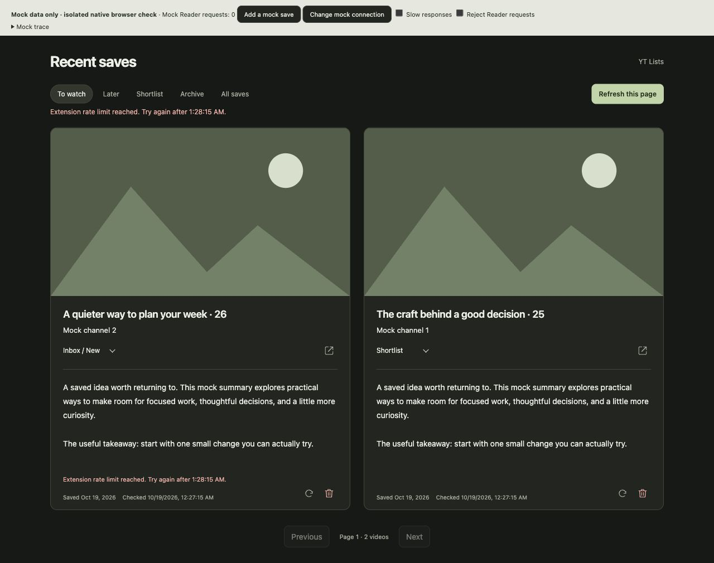

# Recent saves: Reader request pacing

Investigated against merged PR #12 (`8668c6a`) with deterministic, synthetic Reader responses. No real Reader requests, credentials, deletions or note mutations were used.

## Request counts

| Action | Reader HTTP requests |
| --- | --- |
| Open Recent saves / migrate retained local flags | 0 |
| Hydrate cached summaries, change filter/page, redraw after storage notification | 0 |
| Explicit Refresh this page | One exact-ID GET per linked card, at most 12 |
| Refresh one linked card | One exact-ID GET; concurrent same-card refreshes deduplicate |
| Prepare named Trash confirmation | One exact-ID GET |
| Confirm Trash | Fresh exact-ID GET, DELETE, uncached exact-ID verification GET |
| Close confirmation / redraw after deletion | 0 |
| Known-ID YouTube panel/hover cache miss | One GET, sharing the same worker read budget |
| Existing one-click save | One POST; local history/index publication adds no Reader reads |

A successful Recent saves deletion therefore costs **three GETs + one DELETE**. Opening the page does not refresh every card automatically. Local IndexedDB publications can cause redraws, but those redraws do not call Reader.

The public [Reader API documentation](https://readwise.io/reader_api), checked October 19, 2026, specifies 20 list requests/minute/token, 20 deletes/minute/token and 50 updates/minute/token. The extension retains its existing conservative limits of 18 reads, 18 deletes and 45 updates in a rolling minute. Other clients using the token may also consume upstream quota; the extension cannot observe their usage.

The original error code/text conflated two cases: this extension rejecting a request before HTTP because its persisted local budget is exhausted, and Reader returning HTTP 429 with a persisted Retry-After cooldown. The reported message alone cannot establish which happened in Charlie's session.

Deterministic traces explain how only a few deletions can exhaust the read budget:

- Fresh budget: six complete deletions consume 18 GETs; the seventh waits.
- Refresh 12 cards first: two complete deletions consume the remaining six GETs.
- Six prior panel/hover/refresh reads leave room for four deletions; nine prior reads leave room for three.

These are reproducible scenarios, not a claim about the exact preceding requests in the user's browser. Requests rejected by the local limiter never reach Reader, but the old text still blamed Reader.

## Focused change

The three reads serve separate purposes: bind the named confirmation to a fresh document snapshot, detect changes after confirmation before DELETE, and verify exact-ID absence after HTTP 204. No safe removal was identified within the existing conflict/verification requirements, so all three remain. Limits are unchanged; no polling, bulk scan or automatic mutation retry was added.

Before preparing a Recent saves deletion, check capacity for its complete three-read/one-delete cost. This avoids a doomed preparation read and confirmation when too little local capacity remains. A ticket reserves nothing while its dialog is open. On confirmation, check the remaining two-read/one-delete cost again. The Reader operation queue serializes these requests, preventing queued hover/panel reads from consuming the verification slot mid-operation.

This fixes a concrete partial-operation problem: with 16 reads already used, the old flow could prepare, preflight, DELETE successfully, then block its verification locally. The result was correctly uncertain but avoidable. The [baseline/fix trace](reader-rate-capacity-trace.json) records the old three HTTP calls (including DELETE) versus zero calls and an intact mock document with the fix. The regression suite also covers other reads arriving while confirmation is open and a hover read queued during a slow preflight.

The capacity check only covers this extension's local budget. Reader may still return 429 during verification because of upstream or external-client usage. That remains **deletion uncertain**, never a success; its Reader cooldown is retained and displayed. A new confirmation is required after a failed/consumed ticket. No DELETE retries automatically.

Messages now say **Extension rate limit reached** for local pacing, **Reader rate limit reached** for an actual upstream 429/persisted upstream cooldown, and neutral **Request rate limit reached** for an unspecified legacy response. Recent saves, the panel, card preview and temporary summary peek use the same wording and retry time.

## Verification

- `npm test`: 219 passing tests, including consecutive deletes, exact call counts, local-only redraws, shared panel/hover budget, whole-operation capacity, staggered expiry, worker restart, upstream Retry-After (seconds/date/missing/invalid), uncertain verification, and actual panel/peek source text.
- `node --check` over root JS and test JS/CJS, `git diff --check`, manifest asset references and unchanged permissions/CSP checked.
- In-app native browser, offline synthetic fixture: local rejection showed Extension wording, retained both cards, opened no confirmation and made **zero HTTP calls**. Upstream 429 showed Reader wording; a second Trash attempt during cooldown kept the HTTP count at **one** and opened no confirmation.
- Fixture reproduction: `node tests/watch-browser-fixture.cjs`, serve only `output/watch-browser` on loopback, then use `?mode=layout&rate=local` or `?mode=layout&rate=reader`. The fixture blocks real network with CSP and substitutes fake worker/API/storage data.

Real Reader API validation and the loaded user browser were not exercised. Existing document identity, source URL, notes/title/version conflict checks, one-use confirmation scope/expiry and strict DELETE-204-plus-absence verification remain in place.
