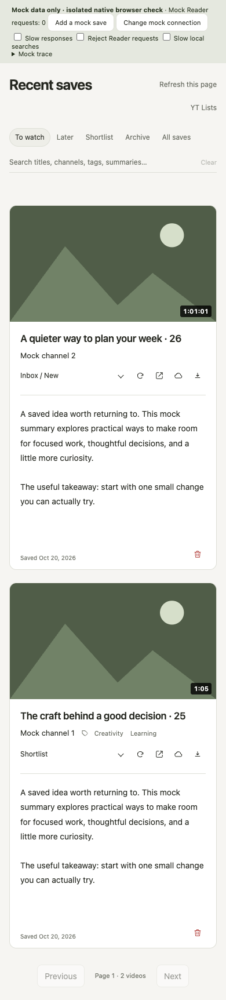
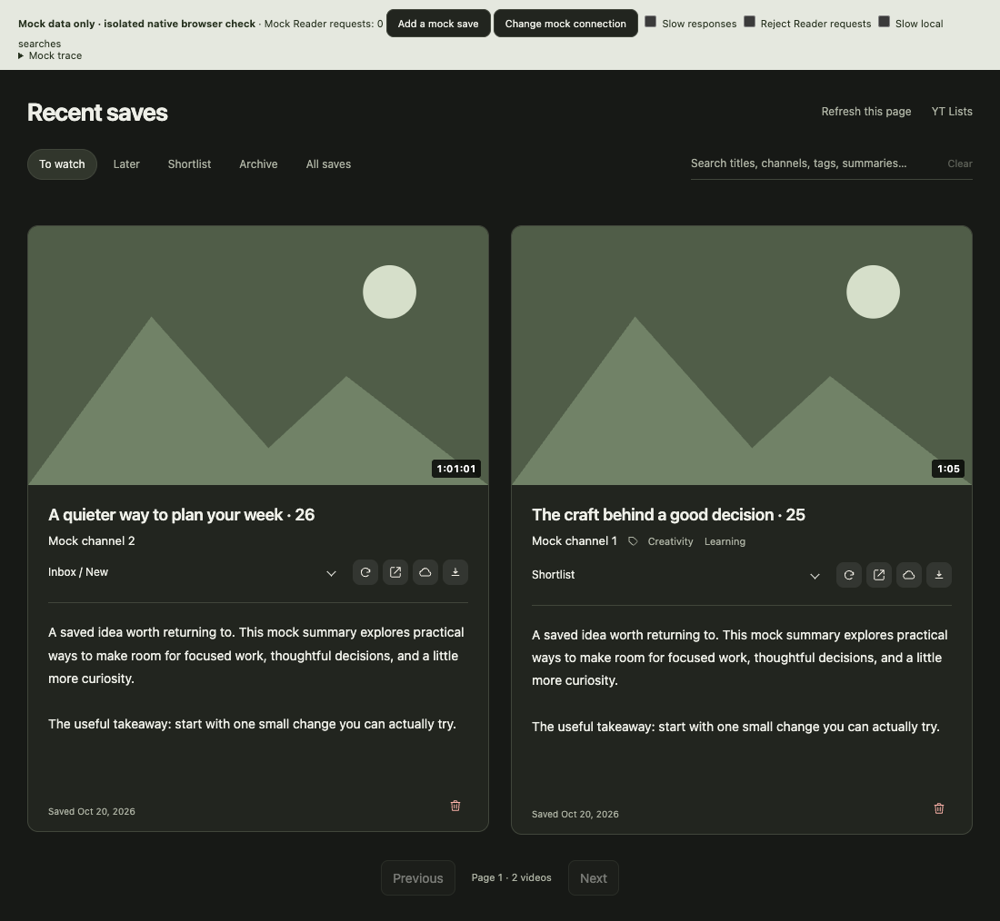

# Recent saves: durations and footer

The footer now shows Saved without the Checked timestamp. `checkedAt`, `summaryCheckedAt`, status verification, location verification and summary-cache eviction keep their existing behavior. This is a display change, not a freshness-policy change.

A small bottom-right thumbnail badge shows known runtime as `m:ss` / `h:mm:ss`. It is an absolute overlay with no hit target, never changes the thumbnail's 16:9 reserved geometry, and stays blank for unknown/live/invalid values. Only finite positive numeric durations are accepted and rounded to seconds. Reader `reading_time` / `listening_time` are never interpreted as runtime.

## Sources and identity

- Content-script saves capture synchronously before sending the save message. Card runtime comes from a duration badge on a card containing only the exact matching video ID. Thumbnail preview clip duration is never used. Live/upcoming cards return no runtime.
- Native watch-player duration requires matching canonical page URL, YouTube watch-container video ID, loaded-metadata binding and media source. Navigation clears the binding; recycled players cannot inherit old runtime. Ads and live/DVR player metadata are excluded. If desktop watch identity or metadata cannot be established (including unsupported page layouts), runtime stays unknown.
- YT Lists saves include their existing item duration and source URL. The worker accepts supplied duration only when its source URL matches the captured save target. A navigation while metadata enrichment runs cannot attach another video's length. Runtime is stored locally, not sent in Reader's save payload.
- New history records use a captured duration or an existing matching YT Lists duration/feed cache. Known durations survive Reader refreshes. A newly observed live state suppresses old cached DVR lengths until a later positive capture establishes a normal runtime.
- Existing IndexedDB rows need no schema rewrite. Each bounded Recent saves page can read through the existing local YT Lists caches for missing lengths, with exact ID/URL validation. Updating those caches refreshes the visible local view. There are no new YouTube/Reader fetches, background backfill, permission changes or full-history migrations. Old items with no known local duration remain blank.

## Validation

`npm test`: 290 passing tests on the PR branch. Tests cover numeric validation/formatting, native metadata and SPA identity, card recycling/multiple IDs, preview clips, ads/live/unknown states, save payload association, persisted duration/freshness preservation, old records/cache enrichment and inert unknown badges.

Native Chromium: `tests/watch-duration.browser.cjs` passes all three cases; the existing two toast browser checks pass too. The fixture uses actual DOM, worker routes and IndexedDB with synthetic data and blocked external traffic. Checks cover 320/390/1100px, light/dark themes, known/unknown/live badges, unavailable thumbnails, constant 16:9 geometry, overlay bounds, no horizontal overflow, automatic local-cache updates, and actual browser metadata/navigation events. Screenshots are synthetic, not private library data.

The existing Reader browser suite has one unrelated failure on unchanged main (`00e3062`): “late save stays on its captured video and preserves edits made while saving” expects “Unsaved draft” but gets “Review conflict.” Its 35 other checks pass. This change does not modify Reader panel/editor code; compare its result separately from the new duration fixture. The combined preview passes 320 unit tests and all five duration/toast browser checks. Its existing Reader suite passes 35/37: the same late-save failure plus “remote HTML stays inert text…” timing out while waiting for the deferred Note iframe. Both failures reproduce on unchanged preview `b53d13e`, before this change.

Reproduce with the repository's optional Playwright runtime:

```sh
node --test tests/watch-duration.browser.cjs tests/watch-toast.browser.cjs
node --test tests/reader-panel.browser.cjs
```

Set `PLAYWRIGHT_MODULE` / `PLAYWRIGHT_CHROMIUM_EXECUTABLE` when using an existing runtime. Browser screenshots/fixtures are generated under `output/playwright/durations/`. No installed extension, user tabs, Reader saves/deletes or browser permissions were changed during validation. Live YouTube layouts/localized badges still need a user smoke test; unsupported or ambiguous cases deliberately stay blank.



