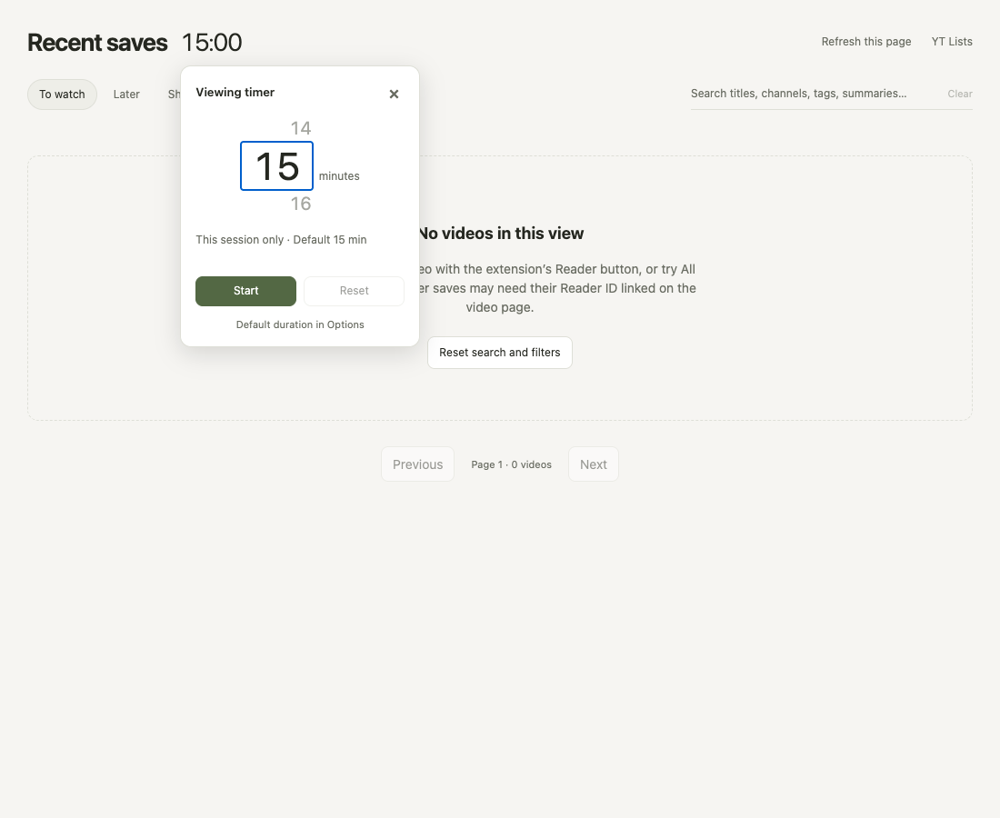
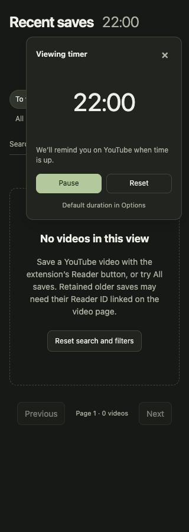
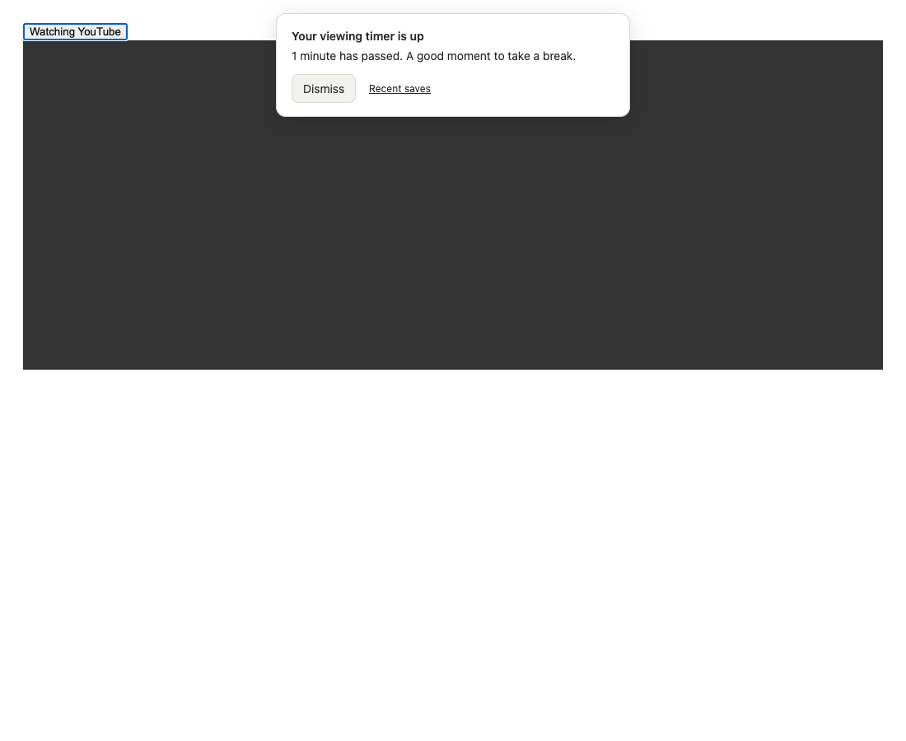

# Recent saves viewing timer

The title has a quiet timer at the same type size, with lighter weight and muted color. Its fixed width and tabular digits prevent countdown layout jumps. The anchored popover has a wheel-style minute picker, a native number input (keyboard/direct input), one-minute buttons, explicit Start, Pause/Resume and Reset. Escape closes and returns focus. Outside click closes without affecting the timer. The timer remains usable without motion or audio.

## Default versus session

`watchTimerDefaultMinutes` is a separate local setting under Options → Reader. Its initial/default value is 15; whole minutes 1–180 are accepted. It applies to new idle timers, persists across reopens, and never changes an existing deadline. The popover's chosen duration belongs only to the current session. Starting/resetting/canceling a one-off timer does not overwrite the configured default. Reset returns to that default.

## Deadline and reminder

The existing service worker serializes timer changes in `watchViewingTimer`, with one ID/revision per session. Running state stores an absolute deadline; paused state stores remaining milliseconds. Rendering derives time from the wall clock rather than subtracting ticks. Repeated starts cannot replace an active/paused timer; captured session IDs prevent stale tabs from controlling a new one. Revision checks reject stale starts. Expiry is committed once and acknowledgement synchronizes across surfaces.

Recent saves and top-level YouTube clients listen to local storage changes. They render locally while running and send only actions/expiry, not a request each second. A visible YouTube page checks the same persisted deadline and displays a dismissible alert even if Recent saves has closed. Reopening after sleep/browser/worker suspension checks the original deadline immediately. Where #23's existing `alarms` permission is already available, one named one-shot alarm can also wake the worker; this PR does not add or request that permission and optional alarm failures do not break the timer.

The reminder follows YouTube navigation/root remounts and attaches inside an HTML fullscreen player. It never changes playback, steals focus, closes a tab, reads the current video's content or calls a remote service. Dismissal acknowledges the session across all pages. No sound is implemented, so autoplay permissions are irrelevant and no audible alert is promised.

A browser cannot display web content while the computer is asleep or the browser is closed; an overdue reminder appears when a YouTube page becomes available again. Native operating-system video fullscreen/Picture-in-Picture can obscure DOM overlays; the reminder is visible again on returning to the page. Already-open YouTube tabs need the updated content scripts loaded before they can show the reminder. No browser reload was performed for the user.

## Validation

- Unit/fake-clock fixtures cover start/pause/resume/reset, expiry boundary, clock jumps/reopen/worker reconstruction, simultaneous starts/expiry, stale session IDs/revisions, malformed durations/state, optional alarm failures, storage guards, client ticks without API polling, late replies and default-versus-session persistence.
- Focused native Chromium fixtures exercise the actual timer UI, reminder, Options and background routes with synthetic Chrome storage and intercepted files. They cover wheel/direct/keyboard input, explicit Start, invalid input, light/dark/320px typography and geometry, pause/resume/reset/Escape, no layout jump, default edits/reopen while a session is running, expiry while Recent saves is closed, cross-page dismissal, HTML fullscreen placement and unchanged video/focus behavior.
- Runtime dependencies and Chromium were reused from existing local installations. No packages/browser builds were installed; no user-browser permissions/settings or Reader data were changed.

Reproduce with the repository's existing optional Playwright setup:

```sh
npm test
node --test tests/watch-timer.browser.cjs tests/watch-toast.browser.cjs
```

`PLAYWRIGHT_MODULE`, `PLAYWRIGHT_CHROMIUM_EXECUTABLE` and `NODE_PATH` may point to existing runtimes. Fixture screenshots go under `output/playwright/viewing-timer/`. Reader panel/editor code is untouched; the previously documented unrelated Reader browser fixture failures are outside this change.

PR-branch checks: **290 unit tests** and **6 focused browser tests** (timer + existing toast checks) pass. Syntax and diff checks pass.




